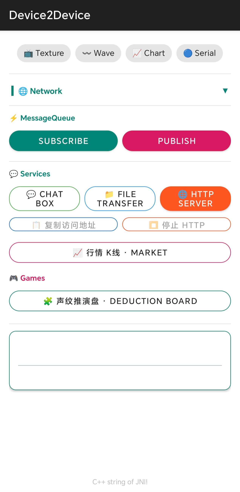

[](https://tsymiar.visualstudio.com/MyAutomatic/_build/latest?definitionId=72&repoName=tsymiar%2FDevice2Device&branchName=main)
[](https://app.codacy.com/gh/tsymiar/Device2Device/dashboard?utm_source=gh&utm_medium=referral&utm_content=&utm_campaign=Badge_grade)


# Device2Device

Android app for peer-to-peer communication and multimedia processing — Bluetooth serial, multi-protocol
networking (incl. a KCP LAN messenger), GPU/media pipelines, a parametric 3D human model, AI chat,
market quotes with home widgets, a voice-deduction board game, and embedded HTTP / SSH servers.
UI layer in Java, heavy lifting in C++ via JNI.

---

## Architecture


### Stack

| Category | Technologies |
| :------- | :----------- |
| Platform | Android **API 26+**, target / compile 31 |
| Language | Java, C++11 |
| Native | JNI, CMake 3.18.1, NDK 23, OpenGL ES 2.0, OpenSL ES, ARM NEON |
| Network | Bluetooth RFCOMM, TCP, UDP multicast, KCP, LAN messenger (KCP over UDP), HTTP, SSH |
| Market Data | Keyless HTTPS: Tencent, Eastmoney, Sina, Binance, Frankfurter (ECB) |
| Media | AudioRecord/Track, MediaExtractor, YUV↔RGB, PCM↔WAV |
| 3D | Parametric mesh + SDF/SurfaceNets, OBJ/MTL export |
| UI | Material Components, ConstraintLayout, custom views, Day/Night |
| Build | Gradle 7.0.2 (AGP 4.1), JDK 8 / 11 |

### Layout

```
app/src/main/
├── java/com/tsymiar/device2device/
│   ├── activity/       # 14: Main (dashboard) / Select / Market / Avatar / Texture /
│   │                   #   Wave / Graph / Sensor / Bt* / Bugger / MyGit / Thanks
│   ├── service/        # Subscribe, Publish, Http (:8080) & Ssh (:2222) server,
│   │                   #   FileMsg server, Receiver, Window, SaveData, Toast
│   ├── dialog/         # ChatBox (multi-provider AI), FileMsg, LanMsg, Game (deduction board)
│   ├── game/           # Deduction engine: propositions, voice samples, psych profile
│   ├── widget/         # Market widgets: list + chart + heatmap (+ config activities)
│   ├── market/         # QuoteSource (11 sources), Quote, CapRow, Indicators
│   ├── avatar/         # AnnyModel/Targets/Params, MeshBuilder, HumanMesh, Renderer, PhotoAnalyzer
│   ├── acceleration/   # Sensor & voice modules
│   ├── entity/ event/  # Data entities, observer bus
│   ├── utils/ view/    # Utilities (Atom, SoundRecord, HttpsRequest …), custom views
│   │                   #   (KLineView, DeductionBoard / DeductionGameScreen …)
│   └── wrapper/        # JNI bridge: callback, network, view, media, time
└── cpp/                # JniMethods, bitmap, callback, codec, convert, display,
                        #   message, socket (kcp submodule), scadup (submodule),
                        #   test, time, utils
```

---

## Features

**Bluetooth** — scanning & pairing, bidirectional RFCOMM serial with directional commands, auto logging, draggable floating receive window.

**Networking** — TCP / UDP multicast / KCP reliable UDP, LAN messenger (KCP-over-UDP text & image chat with UDP-broadcast peer discovery), Pub/Sub floating dialogs, chunked file transfer with progress, HTTP file server (FS + SAF, sortable listing, in-page viewer), SSH server on port 2222.

**LAN messenger** — `LanMsgDialog`: one KCP-over-UDP socket bound to `0.0.0.0:<port>` is both client and server — no connect handshake, peers are addressed by IP; periodic UDP-broadcast discovery with timeout eviction; oversized images are fragmented and reassembled on the peer; discovery address / port configurable.

**Market quotes** — `MarketActivity` + `KLineView`; keyless feeds from `auto` (smart pick + fallback), `tencent`, `eastmoney`, `gold`/`xau`/`gc`, `crude`/`brent`/`ng`, `usd`, `binance`. Code / name / pinyin picker, candles + MA + indicators (MACD, RSI, KDJ), drag-pan, pinch-zoom, crosshair, 15 s refresh.

**Market widgets** — three home-screen widgets bring quotes to the launcher without opening the app. The **quote list** (2×2, resizable) shows several watched symbols at once; rows land one by one as responses arrive, so the widget fills in progressively instead of flashing in all at once. The **quote chart** (2×2, resizable) draws a single symbol's trend as a sparkline, and gold symbols additionally annotate the CNY-per-gram price. The **market cap heatmap** (4×4) paints a squarified treemap of the top-30 A-shares: tile area encodes market cap, colour encodes the daily change, and a tap opens the full quote page. All three share one repaint path that follows day/night mode, size themselves adaptively to their host, and refresh on the same 15 s cadence as the in-app K-line view; each widget ships a configuration activity for picking symbols and the refresh interval.

**Messaging (C++ ↔ Java)** — thread-safe queue + `MASSAGER` enum bridging native events (toast, status, file progress, texture, socket state) to the UI.

**Multimedia** — EGL/GLES2 and CPU image & video rendering, 16 kHz PCM recording with live waveform, WAV/MP4/OGG/MP3/AAC/AMR playback, built-in STT.

**Avatar** — fully on-device parametric body. Photo contributes appearance and silhouette; `Native` engine is SDF + SurfaceNets (procedural), `High-res` uses **Anny** ([naver/anny](https://github.com/naver/anny), Apache-2.0, MakeHuman/CC0) whose phenotype blendshapes are baked offline into `anny.mhb` and solved as `w = Π c`; falls back to `Native` when missing. Silhouette/color extraction, face shapes, 8 hairstyles, life-size measurements (BMI, girths, inseam), GL preview, OBJ+MTL export.

> Rebuild the bundle: `python3 tools/export_anny_targets.py export --anny-dir /path/to/anny --out app/src/main/assets/anny/anny.mhb`
> (`--synthetic` for a placeholder, `selftest` for byte-exactness).

**AI chat** — DeepSeek (built-in key fallback), Ollama (local host editable / Cloud), OpenRouter (free models only). Model lists are fetched per provider; selection is remembered.

**Deduction board** — *Voiceprint Deduction*: full-screen `GameDialog` hosting `DeductionGameScreen`; `DeductionEngine` builds propositions from voice samples (`DeductionAudio`) and tracks the three psychological traps — echo reinforcement, negative overwrite, self-learning; adaptive board text fitting.

**System** — observer event bus, native time sync, global toast, one-tap exit, sensor dashboard with 7.0 m/s² acceleration alert.

---

## Build

Requirements: SDK 31 + Build Tools 30.0.3, NDK 23.0.7599858, CMake 3.18.1, Gradle 7.0.2, JDK 8 / 11.
ABIs: `arm64-v8a`, `armeabi-v7a`, `x86_64`.

```bash
git submodule update --init --recursive   # app/src/main/cpp/scadup, app/src/main/cpp/socket/kcp
./build.sh                                # or: ./build.sh release | clean | cleanall
# BUILD_OFFLINE=1 ./build.sh
```

`build.sh` writes `local.properties` from your environment and copies the APKs to `dist/`.
CI (Azure Pipelines, `macos-latest`) checks out the repo plus the `tsymiar/scadup` submodule and builds all three ABIs.

Permissions: `BLUETOOTH*` (incl. `SCAN`/`CONNECT`/`ADVERTISE`), location (BT scan), `INTERNET`,
`ACCESS_NETWORK_STATE`, `ACCESS_WIFI_STATE`, `CHANGE_WIFI_MULTICAST_STATE`, storage & media read,
`CAMERA`, `RECORD_AUDIO`, `VIBRATE`, `WAKE_LOCK`, `FOREGROUND_SERVICE`,
`SYSTEM_ALERT_WINDOW`, `REQUEST_IGNORE_BATTERY_OPTIMIZATIONS`, `ACTIVITY_RECOGNITION`,
`HIGH_SAMPLING_RATE_SENSORS`, `READ_PHONE_STATE`.

## Screenshots



## License

MIT

## Recent Changes

### 2026-10
- **LAN:** KCP-over-UDP messenger — text/image exchange, UDP-broadcast peer discovery, configurable discovery address and port; kcp protocol vendored under `socket/`.
- **Game:** *Voiceprint Deduction* board — voice samples, proposition synthesis, three psychological traps (echo reinforcement / negative overwrite / self-learning), full-screen dialog with adaptive board text.
- **Market:** 4×4 market-cap heatmap widget (top-30 A-shares by cap; tile area = cap, colour = daily change, tap opens the quote; painted as one tree, 50 tiles per screen); quote-list widget renamed and rows land progressively as data arrives; default K-line symbol switched to Zijin Mining (601899) with a 1-minute intraday chart (previous-close baseline + change scale).
- **ChatBox:** multi-provider (DeepSeek / Ollama local + Cloud / OpenRouter), editable Ollama host, per-provider model lists (OpenRouter free models only).
- **Sensors:** Catmull-Rom smoothed decibel card line and area, control points clamped against overshoot.
- **System:** SSH controls merged into the Network section; MediaCodec video rendered straight into the TextureView surface; Bluetooth connects on a worker thread and stops the floating service on exit.
- **Avatar:** Air Bangs; Anny Bust (taller, rounder, seamless); Hip Fullness calibration.

### 2026-09
- **Avatar:** Anny engine (bundled `anny.mhb`, phenotype scaling), face shapes and hairstyles, real mesh head, A-pose legs, bare feet, body measurements, photo fallback, seam smoothing.
- **Sensors:** scalable dashboard, full-screen compass / level, decibel card.
- **Market:** K-line view (11 data sources) + 2×2 quote list widget.
- **System:** SSH server (port 2222), HTTP server + SAF fixes, dark-mode aware spinner.

### 2026-06
- **Messaging:** `MSG_HINT`, async Pub/Sub with topic isolation, subscription buffer fix, port parsing hardening, UI polish.
